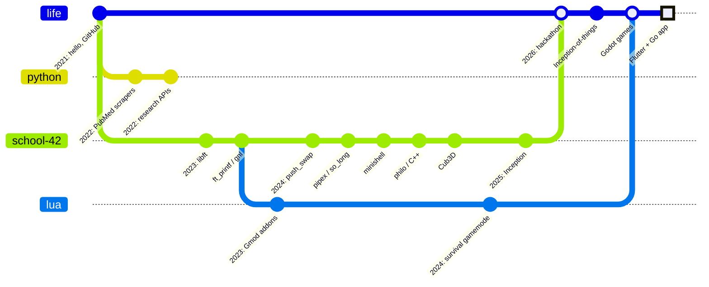
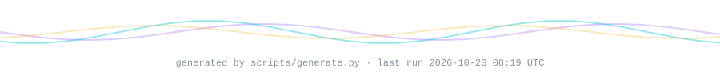

<picture>
  <source media="(prefers-color-scheme: dark)" srcset="assets/generated/header-dark.svg">
  <source media="(prefers-color-scheme: light)" srcset="assets/generated/header-light.svg">
  
</picture>

<picture>
  <source media="(prefers-color-scheme: dark)" srcset="assets/generated/terminal-dark.svg">
  <source media="(prefers-color-scheme: light)" srcset="assets/generated/terminal-light.svg">
  
</picture>

### `$ cat about.md`

I'm Théo, a student at **42 Mulhouse** 🇫🇷. I started out writing Python pipelines for medical research data, fell into C at 42, and now I mostly build things end to end: a Go backend, the Flutter app on top of it, and the Docker / Kubernetes setup underneath.

- 🔭 **Right now:** a Flutter + Go app, and [Inception-of-things](https://github.com/Inheert/Inception-of-things) (K3s, K3d, Argo CD)
- 🎮 **On the side:** small games in Godot, and Garry's Mod gamemodes in Lua since 2023
- 🌱 **Learning:** Kubernetes for real, and writing APIs that don't break their clients
- 💬 **Ask me about:** writing a shell from scratch, philosophers who keep dying, raycasting

### `$ ls ~/projects --sort=pride`

| | Project | What it is | Built with |
|:-:|---|---|---|
| 🐚 | [**minishell**](https://github.com/Inheert/minishell) | A bash-like shell: parsing, pipes, redirections, signals, builtins | C |
| 🧭 | [**Cub3D**](https://github.com/Inheert/Cub3D) | A Wolfenstein-style raycaster | C, MiniLibX |
| ☸️ | [**Inception-of-things**](https://github.com/Inheert/Inception-of-things) | Vagrant + K3s clusters, then GitOps with K3d and Argo CD | Vagrant, K3s, Argo CD |
| 🐳 | [**Inception**](https://github.com/Inheert/Inception) | A small infrastructure of services, each in its own container | Docker Compose |
| 🍝 | [**Philosophers**](https://github.com/Inheert/Philosophers) | The dining philosophers, with threads and mutexes | C, pthreads |
| ♻️ | [**Garbage-collector**](https://github.com/Inheert/Garbage-collector) | A tiny allocator that frees everything for you | C |
| 🏥 | [**hackaton-2026-medisignes**](https://github.com/Inheert/hackaton-2026-medisignes) | A health app built in a weekend at a 2026 hackathon | TypeScript, Expo |
| 🔫 | [**Gmod-survival-gamemode**](https://github.com/Inheert/Gmod-survival-gamemode) | A PvP survival gamemode: characters, admin tools, logging | Lua |

### `$ git log --graph --all ~/life`

### `$ ./skyline --last 365d`

<picture>
  <source media="(prefers-color-scheme: dark)" srcset="assets/generated/skyline-dark.svg">
  <source media="(prefers-color-scheme: light)" srcset="assets/generated/skyline-light.svg">
  
</picture>

<picture>
  <source media="(prefers-color-scheme: dark)" srcset="assets/generated/languages-dark.svg">
  <source media="(prefers-color-scheme: light)" srcset="assets/generated/languages-light.svg">
  
</picture>

### `$ tail -f activity.log`

<!-- ACTIVITY:START -->
1. 🔨 pushed some commit(s) to [Inheert/Inception-of-things](https://github.com/Inheert/Inception-of-things) · 2026-10-08
<!-- ACTIVITY:END -->

<b>🐍 <code>$ ./snake --eat contributions</code></b> (click)

 

<picture>
  <source media="(prefers-color-scheme: dark)" srcset="https://raw.githubusercontent.com/Inheert/Inheert/output/snake-dark.svg">
  <source media="(prefers-color-scheme: light)" srcset="https://raw.githubusercontent.com/Inheert/Inheert/output/snake-light.svg">
  
</picture>

<b>🛠️ <code>$ cat how-this-page-works.md</code></b>

 

No third-party stats service, no visitor counter. Everything above is drawn by [`scripts/generate.py`](scripts/generate.py), about 500 lines of standard-library Python:

1. A [GitHub Action](.github/workflows/profile.yml) runs every night and asks the GraphQL API for my contribution calendar, repos and languages.
2. The script draws each card twice, as hand-written SVG with CSS and SMIL animations, once for the dark theme and once for the light one. `<picture>` picks the one that matches yours.
3. It rewrites the activity log between two HTML comments in this README, and the Action commits the result.

The skyline is an oblique projection of the calendar. Each day is a prism with three faces, drawn back to front so the near towers hide the far ones, and they all grow in a wave when the page loads. Hover a tower to see its day.

<picture>
  <source media="(prefers-color-scheme: dark)" srcset="assets/generated/footer-dark.svg">
  <source media="(prefers-color-scheme: light)" srcset="assets/generated/footer-light.svg">
  
</picture>
